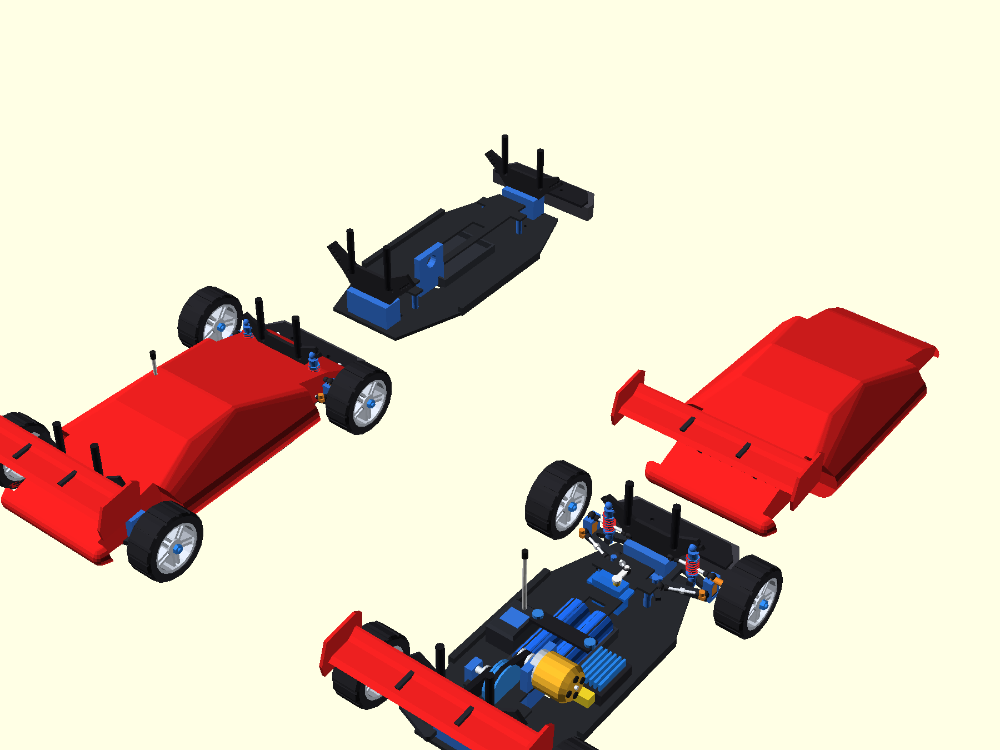
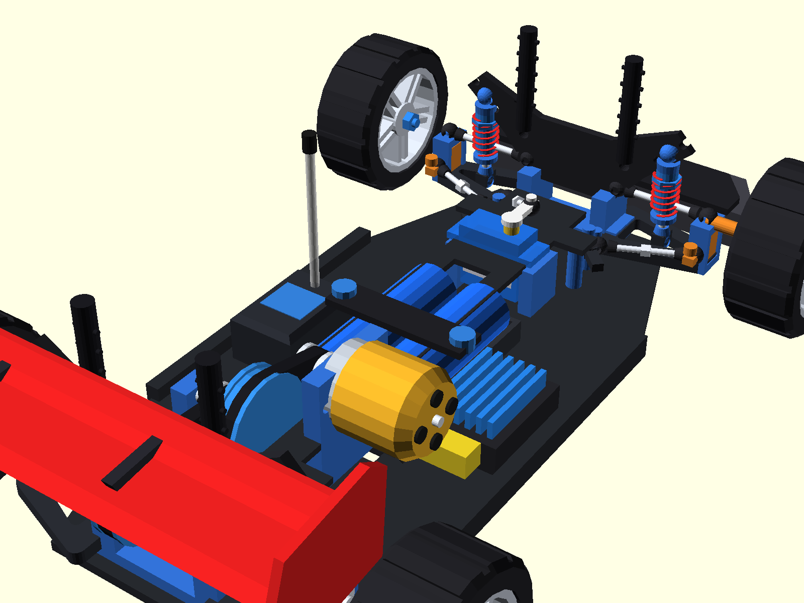
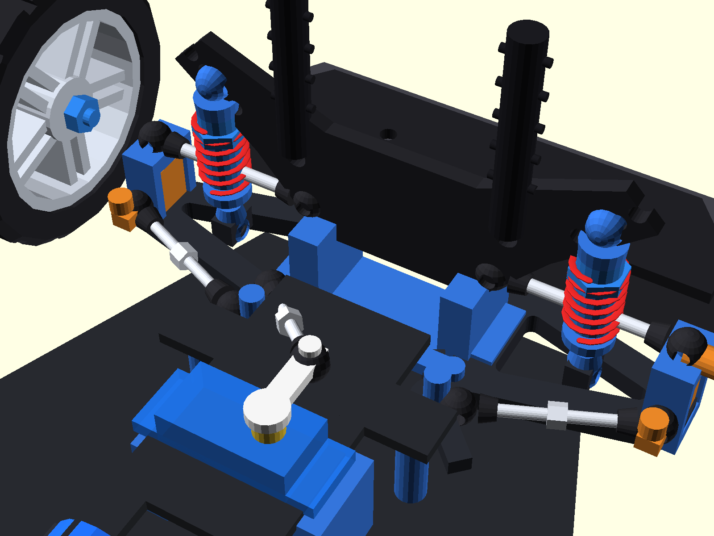
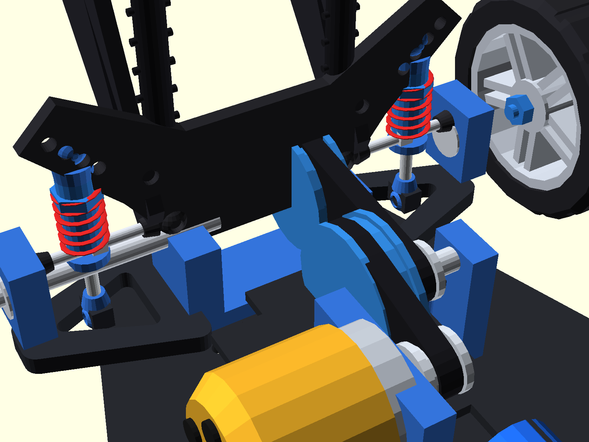

# DIY Flagship RC Controller & Receiver (RC Car & FPV Drone)
## 🏆 Phiên Bản Flagship OS V5 (Lấy Cảm Hứng Từ EdgeTX, RadioMaster & FlySky Noble NB4)

Dự án tay điều khiển từ xa RC DIY chuyên nghiệp toàn diện, tích hợp hệ thống phần mềm và giao diện đẳng cấp từ các thương hiệu tay cầm hàng đầu thế giới (**RadioMaster TX16S / Boxer running EdgeTX** và **FlySky Noble NB4 / Sanwa M17**).

---

## 📸 1. Thiết Kế 3D CAD Tay Cầm Điều Khiển (Transmitter Assembly)


### 📐 Chi Tiết Thiết Kế Cơ Khí & Bố Trí Nội Thất Tay Cầm:
1. **Mặt trước hoàn thiện (Assembled Front Facia):**
   - 2 Cần Joystick Hall Sensor PS2 mượt mà, tự hồi tâm lò xo kép.
   - Màn hình LCD 1604A (16x4 ký tự) với chữ nổi thương hiệu **"Toàn Diện"**.
   - Cụm 3 nút nhấn vật lý điều hướng nhanh **B1 (Lùi) - B2 (Tiếp) - B3 (Chọn / Đổi giá trị)**.
   - Nút nguồn kim loại dạng nhấn nhả kèm vòng LED báo trạng thái pin.
   - 3 Công tắc gạt kim loại: **SW1 (Khóa ga an toàn)**, **SW2 (Chế độ lái 3 vị trí)**, **SW3 (Khóa vi sai / Phụ trợ)**.
   - Chiết áp xoay tinh chỉnh tốc độ tối đa (Speed Limiter).

2. **Bố trí nội thất bên trong (Internal Electronics Layout):**
   - **Nguồn cấp:** Khay 2 pin Li-ion 18650 mắc nối tiếp (2S 7.4V - 8.4V, dung lượng 5000mAh+).
   - **Bo mạch điều khiển trung tâm:** STM32F103C8T6 (Blue Pill) 32-bit ARM Cortex-M3 72MHz.
   - **Mạch truyền sóng RF:** Module SX1280 2.4GHz LoRa công suất cao, gắn kèm chân ăng-ten SMA xuyên nóc hộp.
   - **Mạch sạc & bảo vệ pin:** Cổng USB Type-C hỗ trợ sạc nhanh tiện lợi.
   - **Âm thanh cảnh báo:** Còi chip Active Buzzer báo động khi mất sóng (Failsafe) hoặc pin yếu.

---

## 🏎️ 2. Mô Hình 3D Lắp Ráp Toàn Bộ Linh Kiện Xe Đua RC (Full RC Car Assembly)

Toàn bộ linh kiện cơ khí và điện tử của chiếc xe được dựng chi tiết 100% trong không gian 3D chuẩn xe đua mô hình chuyên nghiệp 1/10 (Touring & Drift):



### 📐 4 Phân Khu Trực Quan Trên Bản Vẽ Tổng Hợp:
1. **Góc Dưới - Bên Trái (Assembled GT Car):** Chiếc xe thể thao hoàn chỉnh với thân vỏ khí động học bo tròn mượt mà, cụm đèn pha LED kép, cản trước bọt biển, 4 bánh xe thể thao và cánh gió đuôi GT Swan-Neck.
2. **Góc Dưới - Bên Phải (Internal Rolling Chassis):** Khung gầm lăn bóc trần 100% linh kiện cơ điện tử hoạt động: Động cơ A2212 chuông vàng, truyền động 2 tầng dây curoa GT2, hệ thống treo 4 càng A độc lập, 4 phuộc nhún lò xo coilover dầu, thước lái đòn khuỷu kép Ackermann, servo lái MG90S, khay pin 2S 18650 có nẹp carbon & ốc siết tay, ESC tản nhiệt xẻ rãnh xanh, mạch thu Receiver LoRa và ăng-ten thẳng đứng.
3. **Góc Trên - Bên Trái (Bare Double-Deck Chassis):** Sàn xe composite 2 tầng với thanh giằng trên carbon, 4 trụ nhôm CNC, cản trước bọt biển & nẹp composite, cụm bulkhead trước/sau và 2 tháp phuộc carbon nhiều lỗ chỉnh góc.
4. **Góc Trên - Bên Phải (Detached GT Body & Spoiler):** Thân vỏ xe thể thao GT khí động học tách rời kèm cánh gió sau kiểu cổ thiên nga (Swan-Neck) tạo lực ép downforce cực đại.

---

### 🧩 Danh Mục Chi Tiết Từng Cụm Cơ Khí Kỹ Thuật Trên Xe:

1. **Khung Sàn 2 Tầng Carbon & Cản Trước Bọt Biển (Double-Deck Chassis & Foam Bumper):**
   - **Sàn dưới (Lower Deck):** Thiết kế vát eo thể thao (waisted), vát mép bo cạnh, các rãnh uốn dẻo cân bằng trọng tâm và giải nhiệt đáy pin.
   - **Cản trước (Front Bumper):** Khối bọt biển dày giảm chấn va đập kết hợp tấm nẹp đè composite carbon có ốc siết M3 cố định.
   - **Sàn tầng 2 (Upper Deck):** Tấm giằng xương sống carbon mỏng 2.2mm gia cố chống vặn xoắn gầm, liên kết với sàn dưới qua 4 trụ nhôm tròn CNC tiện ren.

2. **Hệ Thống Treo Độc Lập 4 Bánh & Càng A Khung Xương (Independent Suspension & Wishbones):**
   - **4 Càng A dưới (Lower A-Arms):** Kết cấu khung xương tam giác rỗng gia cường chịu tải va chạm cao, xỏ trục bản lề thép inox mạ sáng.
   - **4 Thanh Camber trên (Upper Camber Turnbuckles):** Thanh ren điều chỉnh góc nghiêng bánh xe (Camber angle) có đai lục giác giữa để vặn cờ-lê và 2 đầu mắt rotuyn bi (Ball Cups).
   - **Moay-ơ lái & C-Hub trước:** C-Hub nghiêng góc Caster thể thao, moay-ơ xoay êm ái trên trục kingpin; Moay-ơ cầu sau ôm trọn 2 vòng bi bạc đạn chuẩn MR105.

3. **Bộ 4 Phuộc Nhún Dầu Coilover Lò Xo Đỏ (4 Threaded Coilover Oil Shocks):**
   - Thân xylanh phuộc bằng nhôm tiện ren màu xanh dương, tích hợp vòng ốc xoay chỉnh độ nén lò xo (Preload collar).
   - Lò xo thép cuộn xoắn ốc màu đỏ thể thao chịu đàn hồi nhịp nhàng.
   - Ty phuộc bằng inox mạ crom sáng bóng, mắt rotuyn dưới liên kết vững chắc vào càng A.
   - Tháp phuộc trước và sau bằng sợi carbon dày dặn, khoan hàng lỗ bán nguyệt cho phép tinh chỉnh độ ngả góc phuộc nhún linh hoạt theo từng mặt sân đua.

4. **Cơ Cấu Bẻ Lái Ackermann Kép & Micro Servo MG90S:**
   - **Thước lái đòn khuỷu kép (Dual Bellcranks):** 2 Đòn khuỷu xoay quanh 2 trụ lái nhôm, liên kết với nhau bằng thanh cầu ngang Ackermann giúp triệt tiêu góc trượt khi ôm cua.
   - **2 Thanh giằng lái ngang (Tie-Rods):** Nối từ đòn khuỷu ra 2 tay moay-ơ bẻ lái bánh trước bằng thanh ren và đầu rotuyn bi xoay góc mượt mà.
   - **Servo MG90S:** Vỏ xanh dương trong suốt, dàn bánh răng kim loại bên trong bền bỉ, được kẹp chặt bởi 2 trụ nhôm bắt sàn; tay đòn horn nối trực tiếp sang thước lái qua thanh giằng rotuyn.




5. **Động Cơ Không Chổi Than A2212 Chuông Vàng (Brushless Outrunner):**
   - Vỏ chuông ngoài màu vàng Gold (đường kính 27.8mm) với 4 lỗ tản nhiệt xoay tròn.
   - Trục cốt thép chịu lực 3.175mm.
   - Giá đỡ motor nhôm CNC có rãnh oval tịnh tiến tăng/chùng độ căng đai truyền động.
   - 3 Dây pha silicone mềm chịu nhiệt có đầu cos nối trực tiếp vào mạch ESC.

6. **Cơ Cấu Truyền Động 2 Tầng Dây Curoa Giảm Tốc (Dual-Stage Timing Belt Drivetrain):**
   - **Tầng 1:** Puly chủ động 16 răng trên cốt motor kéo Puly lớn 48 răng trên trục trung gian (Tỉ số giảm 1:3).
   - **Tầng 2:** Puly 16 răng trục trung gian kéo Puly 40 răng trên trục cầu sau (Tỉ số giảm 1:2.5).
   - **Tổng tỉ số giảm tốc:** **1:7.5** – Triệt tiêu hoàn toàn hiện tượng giật cục (Anti-Cogging), giúp động cơ A2212 đề-pa cực kỳ êm ái, bốc và đạt vận tốc tối đa 45 - 55 km/h.
   - Dây đai cao su răng cưa chuẩn **GT2** thông dụng, vận hành êm ru không phát tiếng rít kim loại.

7. **Cầu Sau, Bạc Đạn MR105 & 4 Bánh Xe Thể Thao:**
   - Trục láp sau bằng thép 5mm truyền lực trực tiếp ra 2 bánh sau qua 2 cây láp (Dogbones).
   - 2 Cụm gối đỡ bạc đạn chuẩn **MR105** (đường kính ngoài 10mm) bắt cố định vào sàn xe.
   - 4 Bánh xe thể thao: Lốp cao su đen vân gai bám đường chống trượt, mâm đúc hợp kim 5 chấu sao và ốc tán lục giác nhôm xi xanh.

8. **Nguồn Pin & Khoang Điện Tử Nội Thất:**
   - **Pin 2S:** Khay đôi chứa 2 cell pin Li-ion 18650 xanh dương, được ép chặt cố định bằng **Thanh nẹp carbon đè pin** và **2 ốc xoay siết tay nhôm xi xanh (Knurled Thumb Nuts)**, chống văng pin khi xe drift tốc độ cao.
   - **ESC 30A/40A:** Mạch điều tốc không chổi than tích hợp dàn cánh nhôm tản nhiệt màu xanh dương xẻ rãnh khí động học và đầu cắm pin chuẩn XT60 vàng chống chập.
   - **Hộp Mạch Thu Receiver Chống Nước:** Hộp bảo vệ nắp rời kèm ống luồn ăng-ten 2.4GHz thẳng đứng có nắp chụp cao su.

9. **Cánh Gió Khí Động Học GT Cổ Thiên Nga (Swan-Neck High-Downforce Rear Wing):**
   - Cặp chân đỡ nhôm vát cong kiểu cổ thiên nga (Swan-Neck) bắt từ tháp phuộc sau vươn cao ra phía sau, có các lỗ khoét tam giác giảm trọng lượng và lỗ tinh chỉnh góc đón gió.
   - Bản cánh chính biên dạng airfoil camber uốn cong tạo lực ép khí động học (Downforce) nén chặt 2 bánh sau xuống mặt đường khi chạy tốc độ cao, giữ xe luôn ổn định không bị văng đuôi.
   - 2 Tấm vách đứng (Endplates) triệt tiêu dòng khí xoáy đầu cánh.



---

## 🎮 3. Trình Giả Lập 3D Real-Time RC Studio (Simulation Studio)


Người dùng có thể trải nghiệm mô phỏng toàn diện tại file [mo_phong_tay_khien_rc_3d.html](Simulation/mo_phong_tay_khien_rc_3d.html) với đầy đủ:
- **Động lực học xe đua 3D 60FPS:** Xe thể thao GT chạy trên đường nhựa asphalt có vạch kẻ đường, cơ cấu bánh trước bẻ lái thật, bánh xe lăn theo tốc độ, đèn pha LED rọi sáng và đèn phanh đỏ bừng sáng khi phanh.
- **Màn hình LCD 1604A tương tác thực:** Chuyển đổi 7 trang menu trực tiếp, đổi màu nền Xanh dương ↔ Vàng chanh.
- **Bàn điều khiển Studio:** 2 Cần Joystick gạt chuột / chạm cảm ứng / phím bấm `W/S/A/D`, các công tắc gạt và thanh đo xung 8 kênh microsecond thời gian thực.

---

## 🌟 4. Những Tính Năng Độc Bản Đẳng Cấp Hãng Lớn

### 1. 🏎️ Hệ Thống Phanh ABS Điện Tử (Anti-Lock Braking System - Chuẩn FlySky Noble NB4)
- Khi xe phanh gấp ở tốc độ cao (75 km/h), thay vì khóa cứng bánh xe gây trượt lết và mất lái, hệ thống tự động **nhấp nhả xung phanh 12.5Hz (chu kỳ 80ms)**.
- Giữ vững độ bám đường, ôm cua phanh khẩn cấp không bị quăng đuôi, đèn phanh sau chớp giật cảnh báo chân thực!

### 2. 📈 Đồ Thị Đường Cong Expo Trực Quan (EdgeTX Interactive Curve Visualizer)
- Không chỉ là con số phần trăm đơn điệu! Màn hình vẽ trực tiếp **đồ thị hàm số S-Curve $y = x(1-e) + x^3e$** toán học thời gian thực.
- Khi người dùng gạt cần Joystick, một **chấm sáng dạ quang di chuyển theo vị trí ngón tay dọc theo đường cong phản hồi**, giúp căn chỉnh độ êm khi ôm cua cực kỳ trực quan!

### 3. 🎚️ Bộ Đo Kênh Đồ Họa 8 Kênh (RadioMaster 8-Channel Live Monitor)
- Widget hiển thị 8 thanh bar kênh chuyển động song song, vạch tâm 1500µs và độ rộng xung số microsecond chính xác.

### 4. 🚗 Gara Quản Lý 6 Nhà Xe & Đội Bay (Model Garage Slots)
Bộ nhớ lưu trữ sẵn 6 Profile chuyên biệt cho từng dòng mô hình:
1. `🏎️ 01: RWD Drift King` (PWM 333Hz, Expo 40%, ABS Bật, Gyro 65%)
2. `🚙 02: Rock Crawler 4x4` (PWM 50Hz, Crawl Mode, Expo 20%, Mô-men xoắn cao)
3. `🏁 03: 1/10 Touring Racer` (PWM 333Hz, Max 75km/h, Expo 10%, ABS Bật)
4. `🛸 04: 5" FPV Freestyle Drone` (CRSF 420k, 200Hz Zero-Lag, Acro Mode)
5. `🚁 05: Cinewhoop 4K` (CRSF 420k, 150Hz, Altitude-Hold mượt mà)
6. `🚤 06: Speedboat Brushless` (PWM 50Hz, Chống nước, Ga tuyến tính)

### 5. ⏱️ Đồng Hồ Đua Bấm Giờ Vòng (Racing Lap Timer & Stopwatch)
- Tự động kích hoạt khi chạm cần ga, hỗ trợ bấm ngắt giờ từng vòng đua (Lap split, Best Lap record) như các giải đua xe RC chuyên nghiệp.

### 6. ⚡ Đường Truyền SUR/SXR 200Hz Zero-Latency (~3.8ms)
- Tốc độ làm tươi gói tin LoRa E22 lên đến **200Hz** với độ trễ phản xạ chỉ **3.8ms**, nhanh gấp 5 lần chuẩn điều khiển thông thường.

---

## 📟 5. Giao Diện Màn Hình Hệ Điều Hành 7 Trang (LCD 1604A Engine)

Người dùng có thể chuyển đổi nhanh giữa các trang bằng nút bấm **B1 / B2 / B3** hoặc click trực tiếp trên màn hình:
```text
┌────────────────────────────────────────────────────────┐
│ CAR|ARM 200H 4ms   (Trang 1: HUD buồng lái chính)     │
│ S:-48d TX8.2R12V   (Sóng RSSI, Pin Tay Cầm, Pin Xe)    │
│ T:[====|    ]1500  (Thanh đo Ga Throttle Real-Time)    │
│ S:[    |====]1750  (Thanh đo Bẻ Lái Steering)          │
├────────────────────────────────────────────────────────┤
│ Trang 1: [HUD]     - ODO tốc độ, Thanh xung Ga/Lái     │
│ Trang 2: [1.MDL]   - Chọn Xe Đua / Máy Bay FPV         │
│ Trang 3: [2.EXPO]  - Chỉnh độ mượt Expo & Deadband     │
│ Trang 4: [3.ABS]   - Phanh chống trượt ABS & Gyro Drift│
│ Trang 5: [4.KÊNH]  - Giám sát độ rộng xung 8 kênh µs   │
│ Trang 6: [5.TIME]  - Đồng hồ bấm giờ chặng đua Lap     │
│ Trang 7: [6.LƯU]   - Lưu cài đặt vĩnh viễn vào Flash   │
└────────────────────────────────────────────────────────┘
```

---

## 📂 6. Cấu Trúc Thư Mục Dự Án (Repository Structure)

```text
├── CAD/
│   ├── tay_cam_rc_gop_1_file.stl            # Mô hình 3D vỏ tay cầm (Xem trực tiếp trên GitHub)
│   ├── tay_cam_rc_gop_1_file.step           # File CAD STEP chuẩn kỹ thuật vỏ tay cầm
│   ├── xe_rc_tong_hop_day_du_chi_tiet.stl  # Mô hình 3D tổng hợp 4 góc nhìn xe RC (Xem 3D trực tiếp trên GitHub)
│   ├── xe_rc_tong_hop_day_du_chi_tiet.step # File CAD STEP solid 4 phân khu xe RC (Mở bằng Shapr3D, SolidWorks)
│   ├── xe_rc_chassis_a2212_spoiler.stl      # Mô hình 3D xe đua đơn lẻ đầy đủ linh kiện
│   └── xe_rc_chassis_a2212_spoiler.step     # File CAD STEP kỹ thuật xe đua đơn lẻ
├── Firmware/
│   ├── TayCam_Transmitter_STM32_PRO/
│   │   └── TayCam_Transmitter_STM32_PRO.ino  # Code STM32 Flagship OS (ABS, Expo Curve, 6 Gara, 200Hz)
│   └── BoThu_Receiver_All_In_One_PRO/
│       └── BoThu_Receiver_All_In_One_PRO.ino # Code Mạch Thu All-In-One (CRSF 420k + PWM 333Hz)
├── Images/
│   ├── thiet_ke_cad_tay_cam_3d.png           # Ảnh 3D CAD tay cầm 4 góc nhìn nội thất và ngoại thất
│   ├── xe_rc_tong_hop_4_goc_nhin.png         # Ảnh 3D CAD xe đua tổng hợp 4 góc nhìn như tay cầm
│   ├── thiet_ke_khung_xe_a2212_spoiler.png   # Ảnh phối cảnh 3D xe đua đầy đủ 100% linh kiện
│   ├── chi_tiet_canh_gio_gt.png              # Ảnh chi tiết đuôi xe, cánh gió GT và truyền động 2 curoa
│   ├── xe_rc_full_components_top.png         # Ảnh chi tiết từ trên xuống: Pin 18650, ESC, RX, Servo
│   └── giao_dien_mo_phong_rc_studio.png      # Ảnh chụp giao diện Studio giả lập 3D WebGL
├── Simulation/
│   └── mo_phong_tay_khien_rc_3d.html         # Trình giả lập 3D 60FPS + Giao diện Studio chuyên nghiệp
└── README.md
```

---

## 📄 Bản Quyền (License)
Dự án phát hành theo giấy phép **MIT License** - Hoàn toàn mã nguồn mở cho cộng đồng RC & Drone Maker.
