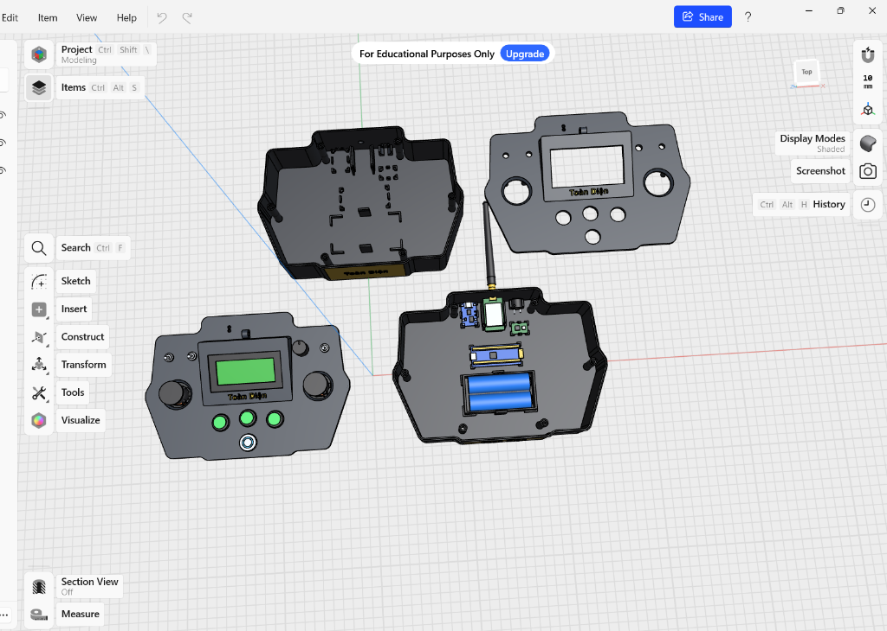
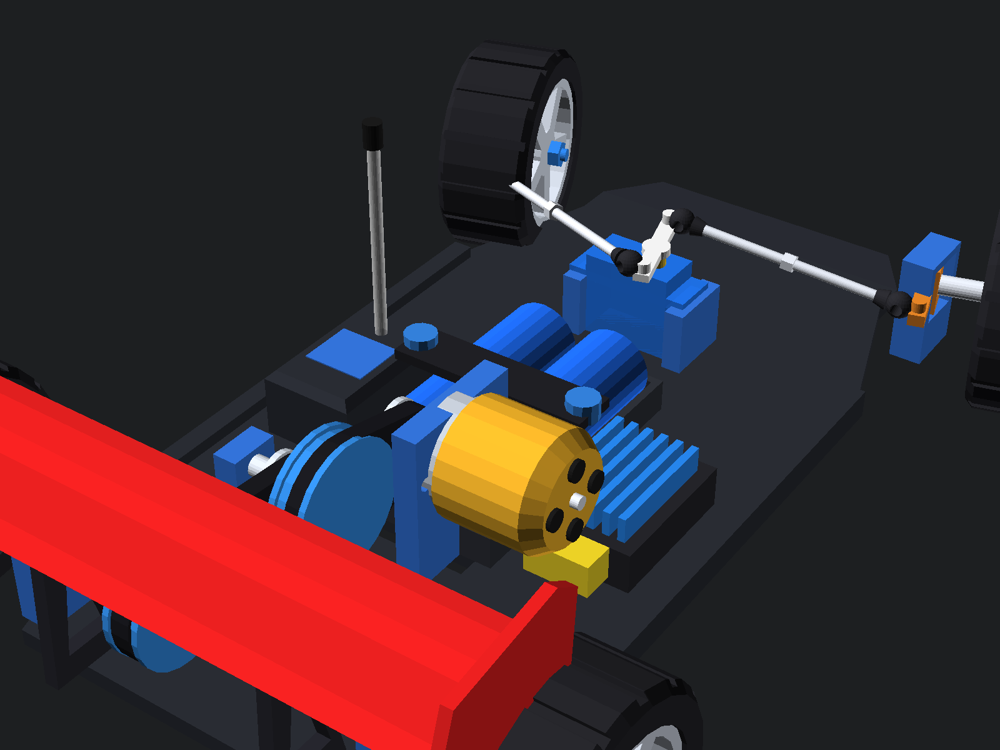
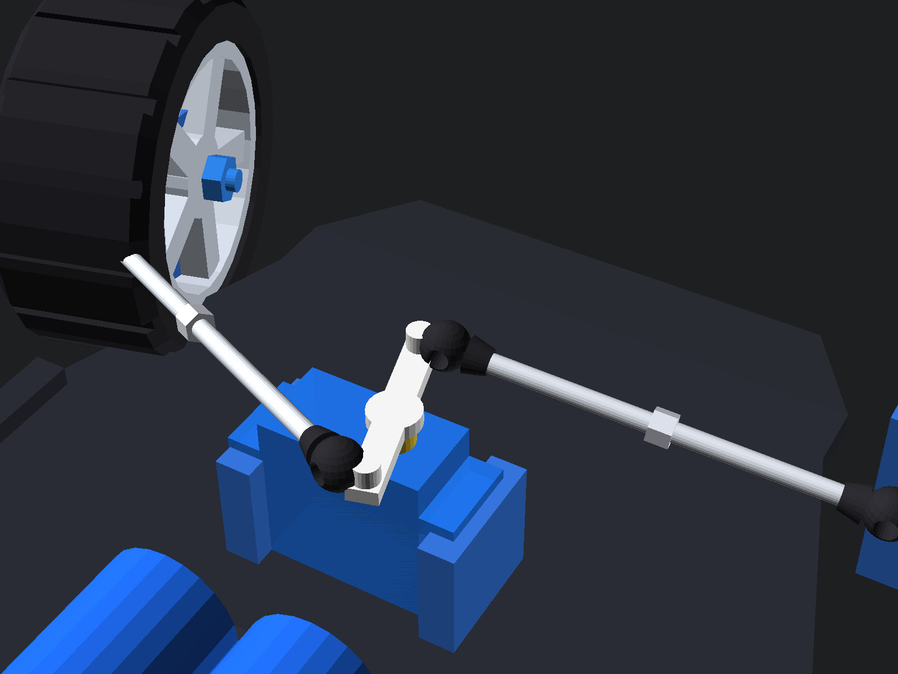
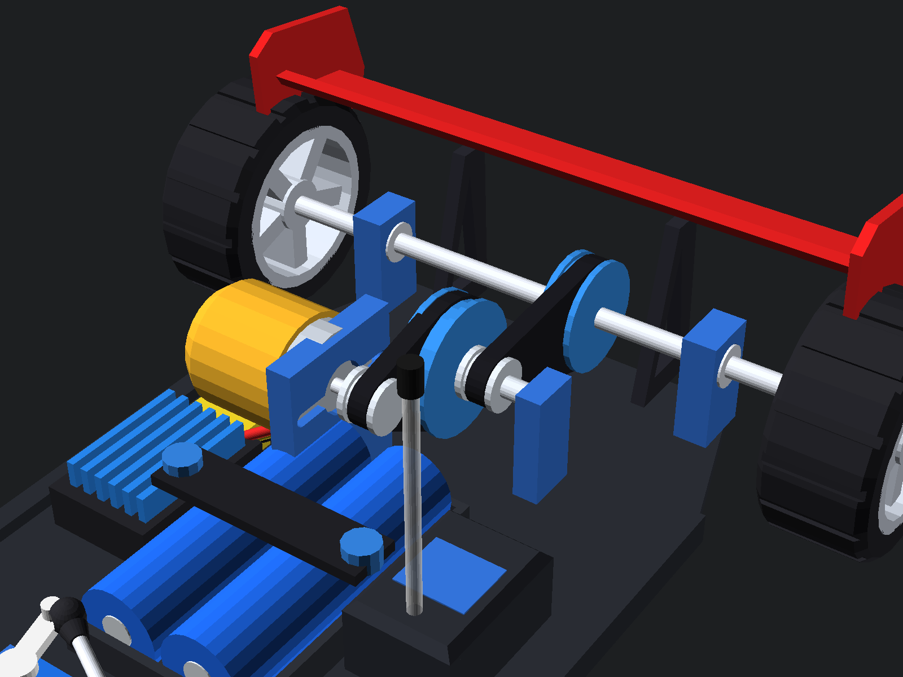
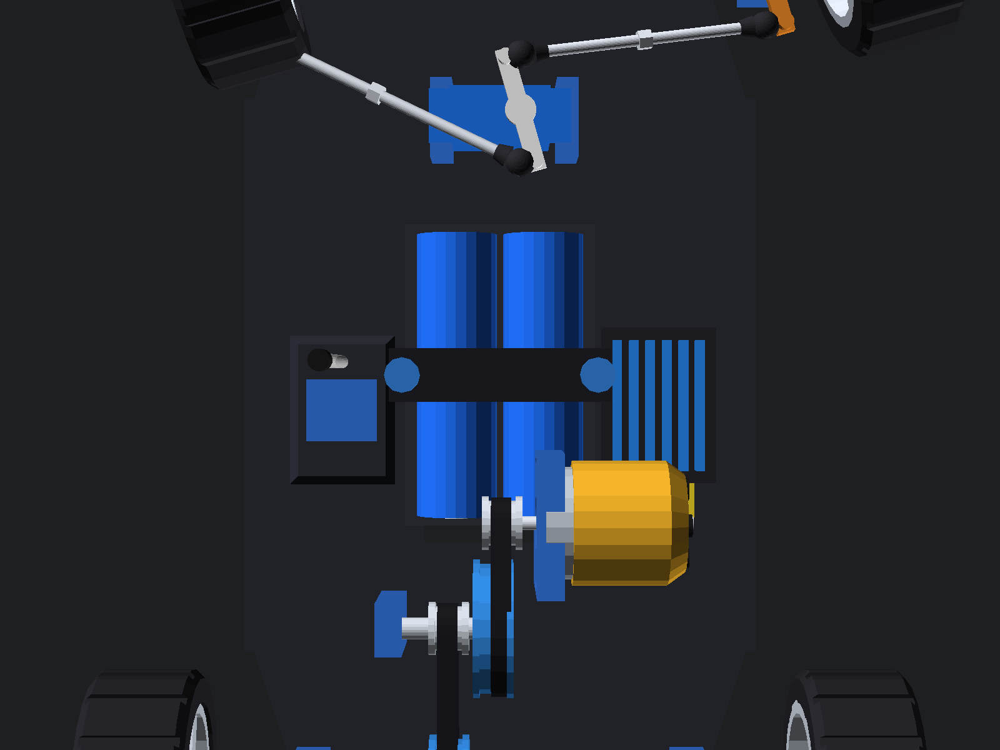
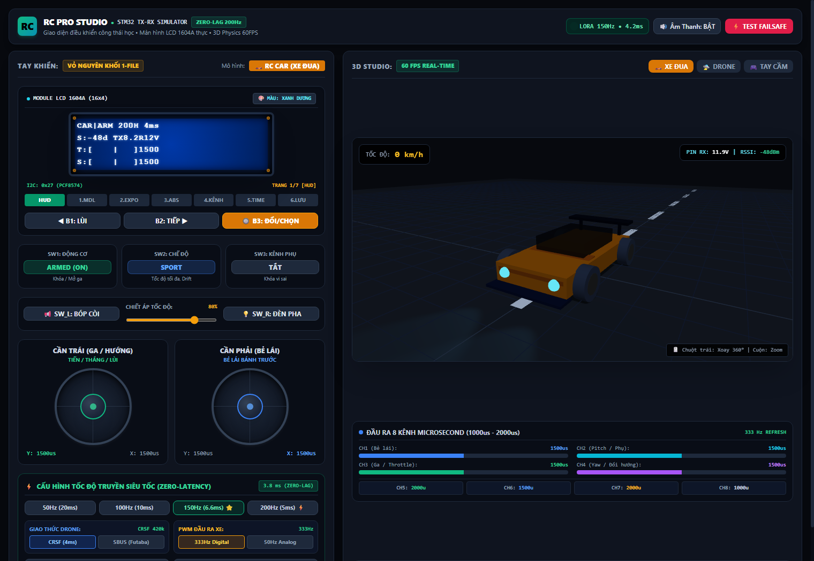

# DIY Flagship RC Controller & Receiver (RC Car & FPV Drone)
## 🏆 Phiên Bản Flagship OS V5 (Lấy Cảm Hứng Từ EdgeTX, RadioMaster & FlySky Noble NB4)

Dự án tay điều khiển từ xa RC DIY chuyên nghiệp toàn diện, tích hợp hệ thống phần mềm và giao diện đẳng cấp từ các thương hiệu tay cầm hàng đầu thế giới (**RadioMaster TX16S / Boxer running EdgeTX** và **FlySky Noble NB4 / Sanwa M17**).

---

## 📸 1. Thiết Kế 3D CAD Tay Cầm Điều Khiển (Transmitter Assembly)



### 📐 Chi Tiết Thiết Kế Cơ Khí & Bố Trí Nội Thất Tay Cầm:
1. **Mặt trước hoàn thiện (Assembled Front Facia):**
   - 2 Cần Joystick Hall Sensor PS2 mượt mà, tự hồi tâm lò xo kép.
   - Màn hình LCD 1604A (16x4 ký tự) với chữ nổi thương hiệu **"Toàn Diện"**.
   - Cụm 3 nút nhấn vật lý điều hướng nhanh **B1 (Lùi) - B2 (Tiếp) - B3 (Chọn / Đổi giá trị)**.
   - Nút nguồn kim loại dạng nhấn nhả kèm vòng LED báo trạng thái pin.
   - 3 Công tắc gạt kim loại: **SW1 (Khóa ga an toàn)**, **SW2 (Chế độ lái 3 vị trí)**, **SW3 (Khóa vi sai / Phụ trợ)**.
   - Chiết áp xoay tinh chỉnh tốc độ tối đa (Speed Limiter).

2. **Bố trí nội thất bên trong (Internal Electronics Layout):**
   - **Nguồn cấp:** Khay 2 pin Li-ion 18650 mắc nối tiếp (2S 7.4V - 8.4V, dung lượng 5000mAh+).
   - **Bo mạch điều khiển trung tâm:** STM32F103C8T6 (Blue Pill) 32-bit ARM Cortex-M3 72MHz.
   - **Mạch truyền sóng RF:** Module SX1280 2.4GHz LoRa công suất cao, gắn kèm chân ăng-ten SMA xuyên nóc hộp.
   - **Mạch sạc & bảo vệ pin:** Cổng USB Type-C hỗ trợ sạc nhanh tiện lợi.
   - **Âm thanh cảnh báo:** Còi chip Active Buzzer báo động khi mất sóng (Failsafe) hoặc pin yếu.

---

## 🏎️ 2. Mô Hình 3D Xe Đua RC Tối Giản Cứng Vững - Cơ Cấu Bẻ Lái Thực Tế (Không Giảm Xóc Rườm Rà)

Để tối ưu hóa cho việc **tự in 3D FDM tại nhà**, xe loại bỏ các cụm phuộc nhún lò xo phức tạp dễ kẹt rít hay gãy vỡ, tập trung hoàn thiện **khung sàn phẳng cứng vững (Pan-Car / Kart Chassis)** kết hợp **hệ thống bẻ lái thực tế ("quặt lái") cực kỳ mượt mà và chính xác**:



### 📐 Chi Tiết Các Cụm Cơ Khí Kỹ Thuật Đã Dựng Đầy Đủ 100%:

1. **Hệ Thống Bẻ Lái Thực Tế (Cơ Cấu Quặt Góc Mượt Mà):**
   - **Servo Lái MG90S Bánh Răng Kim Loại:** Được định vị chắc chắn giữa đầu xe bằng 2 bát kẹp nhôm xi xanh bắt cứng vào sàn.
   - **Tay đòn Servo Horn 2 cánh:** Xoay chủ động theo góc điều khiển vô-lăng từ tay cầm.
   - **2 Thanh giằng lái thép (Tie-Rods):** Thanh ren inox kết hợp đai ốc lục giác và **4 khớp đầu mắt rotuyn bi (Ball Joints)** xoay đa hướng chống kẹt.
   - **C-Block & Trục đứng Kingpin:** 2 Khối gối đỡ moay-ơ bắt thẳng trên sàn xe với chốt xoay Kingpin trên/dưới.
   - **Moay-ơ bẻ lái (Steering Knuckles):** Xoay tự do quanh trục Kingpin, tay đòn moay-ơ nhận lực đẩy/kéo từ rotuyn giúp 2 bánh trước quặt góc chuẩn xác!



2. **Khung Sàn Xe Tối Ưu Cho In 3D (Rigid Pan-Car Chassis):**
   - Bản sàn dày 4.0mm kết cấu nguyên khối, mũi xe vát khí động học.
   - 2 Gờ gia cường dày 7mm chạy dọc 2 mép sườn xe triệt tiêu hoàn toàn độ cong vẹo khi ôm cua tốc độ cao.
   - Các khe hở rãnh gió đáy gầm giúp làm mát pack pin 18650 hiệu quả.

3. **Cầu Sau, Động Cơ A2212 & Truyền Động 2 Tầng Dây Curoa GT2:**
   - **Động cơ không chổi than A2212:** Vỏ chuông vàng Gold đặc trưng, cốt thép 3.175mm, giá bắt motor nhôm có 2 rãnh oval trượt tịnh tiến để căn chỉnh độ căng chùng của dây curoa.
   - **Hộp số giảm tốc 2 tầng dây curoa GT2:**
     - Tầng 1: Puly 16T cốt motor -> Puly 48T trục trung gian (giảm 1:3).
     - Tầng 2: Puly 16T trục trung gian -> Puly 40T trên trục bánh sau (giảm 1:2.5).
     - **Tổng tỉ số giảm 1:7.5:** Đề-pa êm ái, mô-men xoắn mạnh mẽ, không bị giật khựng (Anti-cogging) và êm ru không tiếng rít kim loại.
   - **Trục cầu sau thép 5mm:** Nối thẳng 2 bánh sau, quay trơn tru trên 2 cụm gối đỡ bạc đạn chuẩn **MR105**.



4. **Cánh Gió Đuôi GT Thể Thao Khí Động Học:**
   - Cặp chân đế cánh gió dạng vát xiên khí động học bắt trực tiếp vào đuôi sàn xe, có lỗ khoét rỗng giảm trọng lượng.
   - Bản cánh gió chính sải rộng 150mm biên dạng airfoil camber cong nhẹ tạo lực ép xuống mặt đường (Downforce) khi xe bứt tốc.
   - 2 Tấm vách đứng chặn gió bên (Endplates) hạn chế tối đa nhiễu động khí xoáy.

5. **Nguồn Pin & Bố Trí Khoang Điện Tử Nội Thất:**
   - **Pack pin 2S:** Khay chứa 2 viên pin Li-ion 18650 xanh dương, ép chặt bằng thanh nẹp carbon đè ngang và 2 đai ốc siết tay (Knurled Thumb Nuts).
   - **ESC 30A:** Tản nhiệt xẻ rãnh màu xanh dương chống quá nhiệt kèm cổng giắc cắm XT60.
   - **Hộp Receiver LoRa 2.4GHz:** Hộp bảo vệ vi mạch kín nước với ống luồn ăng-ten thẳng đứng có nắp chụp cao su.



---

## 🎮 3. Trình Giả Lập 3D Real-Time RC Studio (Simulation Studio)



Người dùng có thể trải nghiệm mô phỏng toàn diện tại file [mo_phong_tay_khien_rc_3d.html](Simulation/mo_phong_tay_khien_rc_3d.html) với đầy đủ:
- **Động lực học xe đua 3D 60FPS:** Xe thể thao GT chạy trên đường nhựa asphalt có vạch kẻ đường, cơ cấu bánh trước bẻ lái thật, bánh xe lăn theo tốc độ, đèn pha LED rọi sáng và đèn phanh đỏ bừng sáng khi phanh.
- **Màn hình LCD 1604A tương tác thực:** Chuyển đổi 7 trang menu trực tiếp, đổi màu nền Xanh dương ↔ Vàng chanh.
- **Bàn điều khiển Studio:** 2 Cần Joystick gạt chuột / chạm cảm ứng / phím bấm `W/S/A/D`, các công tắc gạt và thanh đo xung 8 kênh microsecond thời gian thực.

---

## 🌟 4. Những Tính Năng Độc Bản Đẳng Cấp Hãng Lớn

### 1. 🏎️ Hệ Thống Phanh ABS Điện Tử (Anti-Lock Braking System - Chuẩn FlySky Noble NB4)
- Khi xe phanh gấp ở tốc độ cao (75 km/h), thay vì khóa cứng bánh xe gây trượt lết và mất lái, hệ thống tự động **nhấp nhả xung phanh 12.5Hz (chu kỳ 80ms)**.
- Giữ vững độ bám đường, ôm cua phanh khẩn cấp không bị quăng đuôi, đèn phanh sau chớp giật cảnh báo chân thực!

### 2. 📈 Đồ Thị Đường Cong Expo Trực Quan (EdgeTX Interactive Curve Visualizer)
- Không chỉ là con số phần trăm đơn điệu! Màn hình vẽ trực tiếp **đồ thị hàm số S-Curve $y = x(1-e) + x^3e$** toán học thời gian thực.
- Khi người dùng gạt cần Joystick, một **chấm sáng dạ quang di chuyển theo vị trí ngón tay dọc theo đường cong phản hồi**, giúp căn chỉnh độ êm khi ôm cua cực kỳ trực quan!

### 3. 🎚️ Bộ Đo Kênh Đồ Họa 8 Kênh (RadioMaster 8-Channel Live Monitor)
- Widget hiển thị 8 thanh bar kênh chuyển động song song, vạch tâm 1500µs và độ rộng xung số microsecond chính xác.

### 4. 🚗 Gara Quản Lý 6 Nhà Xe & Đội Bay (Model Garage Slots)
Bộ nhớ lưu trữ sẵn 6 Profile chuyên biệt cho từng dòng mô hình:
1. `🏎️ 01: RWD Drift King` (PWM 333Hz, Expo 40%, ABS Bật, Gyro 65%)
2. `🚙 02: Rock Crawler 4x4` (PWM 50Hz, Crawl Mode, Expo 20%, Mô-men xoắn cao)
3. `🏁 03: 1/10 Touring Racer` (PWM 333Hz, Max 75km/h, Expo 10%, ABS Bật)
4. `🛸 04: 5" FPV Freestyle Drone` (CRSF 420k, 200Hz Zero-Lag, Acro Mode)
5. `🚁 05: Cinewhoop 4K` (CRSF 420k, 150Hz, Altitude-Hold mượt mà)
6. `🚤 06: Speedboat Brushless` (PWM 50Hz, Chống nước, Ga tuyến tính)

### 5. ⏱️ Đồng Hồ Đua Bấm Giờ Vòng (Racing Lap Timer & Stopwatch)
- Tự động kích hoạt khi chạm cần ga, hỗ trợ bấm ngắt giờ từng vòng đua (Lap split, Best Lap record) như các giải đua xe RC chuyên nghiệp.

### 6. ⚡ Đường Truyền SUR/SXR 200Hz Zero-Latency (~3.8ms)
- Tốc độ làm tươi gói tin LoRa E22 lên đến **200Hz** với độ trễ phản xạ chỉ **3.8ms**, nhanh gấp 5 lần chuẩn điều khiển thông thường.

---

## 📟 5. Giao Diện Màn Hình Hệ Điều Hành 7 Trang (LCD 1604A Engine)

Người dùng có thể chuyển đổi nhanh giữa các trang bằng nút bấm **B1 / B2 / B3** hoặc click trực tiếp trên màn hình:
```text
┌────────────────────────────────────────────────────────┐
│ CAR|ARM 200H 4ms   (Trang 1: HUD buồng lái chính)     │
│ S:-48d TX8.2R12V   (Sóng RSSI, Pin Tay Cầm, Pin Xe)    │
│ T:[====|    ]1500  (Thanh đo Ga Throttle Real-Time)    │
│ S:[    |====]1750  (Thanh đo Bẻ Lái Steering)          │
├────────────────────────────────────────────────────────┤
│ Trang 1: [HUD]     - ODO tốc độ, Thanh xung Ga/Lái     │
│ Trang 2: [1.MDL]   - Chọn Xe Đua / Máy Bay FPV         │
│ Trang 3: [2.EXPO]  - Chỉnh độ mượt Expo & Deadband     │
│ Trang 4: [3.ABS]   - Phanh chống trượt ABS & Gyro Drift│
│ Trang 5: [4.KÊNH]  - Giám sát độ rộng xung 8 kênh µs   │
│ Trang 6: [5.TIME]  - Đồng hồ bấm giờ chặng đua Lap     │
│ Trang 7: [6.LƯU]   - Lưu cài đặt vĩnh viễn vào Flash   │
└────────────────────────────────────────────────────────┘
```

---

## 📂 6. Cấu Trúc Thư Mục Dự Án (Repository Structure)

```text
├── CAD/
│   ├── tay_cam_rc_gop_1_file.stl            # Mô hình 3D vỏ tay cầm (Xem trực tiếp trên GitHub)
│   ├── tay_cam_rc_gop_1_file.step           # File CAD STEP chuẩn kỹ thuật vỏ tay cầm
│   ├── xe_rc_day_du_linh_kien.stl           # Mô hình 3D xe đua cơ cấu quặt lái thực tế, không giảm xóc (Xem 3D trực tiếp trên GitHub)
│   ├── xe_rc_day_du_linh_kien.step          # File CAD STEP kỹ thuật xe đua cơ cấu quặt lái (Shapr3D, SolidWorks, FreeCAD)
│   ├── xe_rc_chassis_a2212_spoiler.stl      # Bản sao tương thích STL xe đua đầy đủ linh kiện
│   └── xe_rc_chassis_a2212_spoiler.step     # Bản sao tương thích STEP xe đua đầy đủ linh kiện
├── Firmware/
│   ├── TayCam_Transmitter_STM32_PRO/
│   │   └── TayCam_Transmitter_STM32_PRO.ino  # Code STM32 Flagship OS (ABS, Expo Curve, 6 Gara, 200Hz)
│   └── BoThu_Receiver_All_In_One_PRO/
│       └── BoThu_Receiver_All_In_One_PRO.ino # Code Mạch Thu All-In-One (CRSF 420k + PWM 333Hz)
├── Images/
│   ├── thiet_ke_cad_tay_cam_3d.png           # Ảnh 3D CAD tay cầm 4 góc nhìn nội thất và ngoại thất
│   ├── xe_rc_day_du_iso.png                  # Ảnh 3D CAD tổng thể xe đua RC bẻ lái thực tế
│   ├── xe_rc_day_du_steer.png                # Ảnh cận cảnh hệ thống quặt lái: Servo MG90S và thanh giằng rotuyn
│   ├── xe_rc_day_du_rear.png                 # Ảnh cận cảnh cầu sau, động cơ A2212, puly 2 tầng và cánh gió GT
│   ├── xe_rc_day_du_top.png                  # Ảnh góc nhìn từ trên xuống bố trí linh kiện điện tử
│   └── giao_dien_mo_phong_rc_studio.png      # Ảnh chụp giao diện Studio giả lập 3D WebGL
├── Simulation/
│   └── mo_phong_tay_khien_rc_3d.html         # Trình giả lập 3D 60FPS + Giao diện Studio chuyên nghiệp
└── README.md
```

---

## 📄 Bản Quyền (License)
Dự án phát hành theo giấy phép **MIT License** - Hoàn toàn mã nguồn mở cho cộng đồng RC & Drone Maker.
