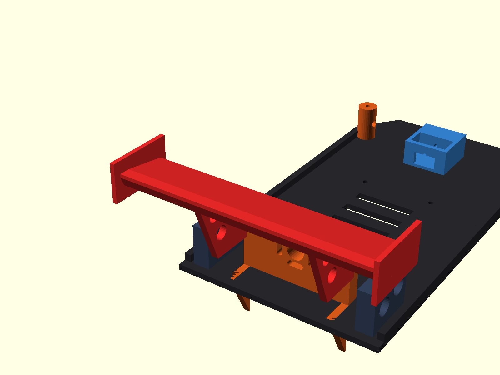
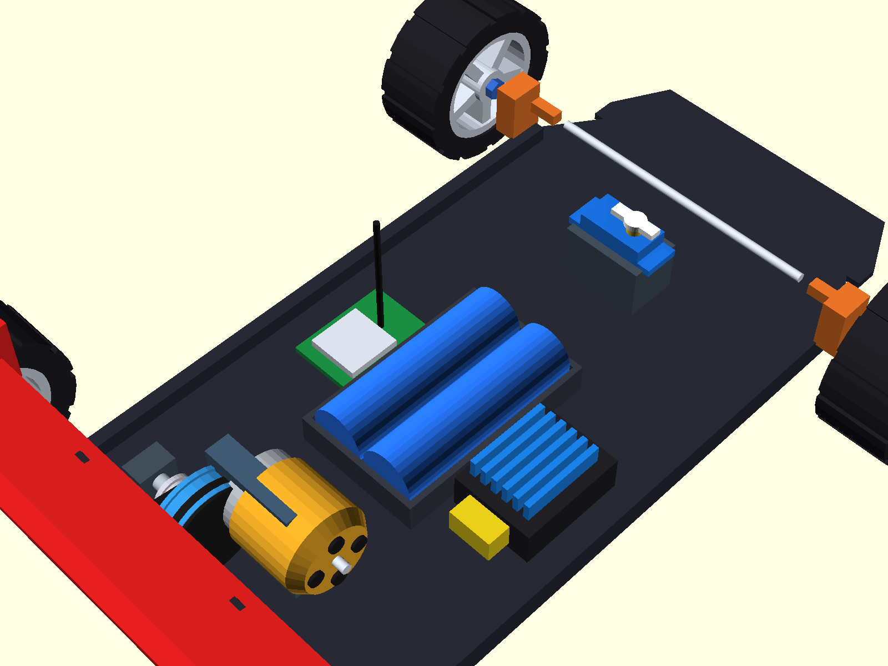

# DIY Flagship RC Controller & Receiver (RC Car & FPV Drone)
## 🏆 Phiên Bản Flagship OS V5 (Lấy Cảm Hứng Từ EdgeTX, RadioMaster & FlySky Noble NB4)

Dự án tay điều khiển từ xa RC DIY chuyên nghiệp toàn diện, tích hợp hệ thống phần mềm và giao diện đẳng cấp từ các thương hiệu tay cầm hàng đầu thế giới (**RadioMaster TX16S / Boxer running EdgeTX** và **FlySky Noble NB4 / Sanwa M17**).

---

## 📸 1. Thiết Kế 3D CAD Tay Cầm Điều Khiển (Transmitter Assembly)


### 📐 Chi Tiết Thiết Kế Cơ Khí & Bố Trí Nội Thất Tay Cầm:
1. **Mặt trước hoàn thiện (Assembled Front Facia):**
   - 2 Cần Joystick Hall Sensor PS2 mượt mà, tự hồi tâm lò xo kép.
   - Màn hình LCD 1604A (16x4 ký tự) với chữ nổi thương hiệu **"Toàn Diện"**.
   - Cụm 3 nút nhấn vật lý điều hướng nhanh **B1 (Lùi) - B2 (Tiếp) - B3 (Chọn / Đổi giá trị)**.
   - Nút nguồn kim loại dạng nhấn nhả kèm vòng LED báo trạng thái pin.
   - 3 Công tắc gạt kim loại: **SW1 (Khóa ga an toàn)**, **SW2 (Chế độ lái 3 vị trí)**, **SW3 (Khóa vi sai / Phụ trợ)**.
   - Chiết áp xoay tinh chỉnh tốc độ tối đa (Speed Limiter).

2. **Bố trí nội thất bên trong (Internal Electronics Layout):**
   - **Nguồn cấp:** Khay 2 pin Li-ion 18650 mắc nối tiếp (2S 7.4V - 8.4V, dung lượng 5000mAh+).
   - **Bo mạch điều khiển trung tâm:** STM32F103C8T6 (Blue Pill) 32-bit ARM Cortex-M3 72MHz.
   - **Mạch truyền sóng RF:** Module SX1280 2.4GHz LoRa công suất cao, gắn kèm chân ăng-ten SMA xuyên nóc hộp.
   - **Mạch sạc & bảo vệ pin:** Cổng USB Type-C hỗ trợ sạc nhanh tiện lợi.
   - **Âm thanh cảnh báo:** Còi chip Active Buzzer báo động khi mất sóng (Failsafe) hoặc pin yếu.

---

## 🏎️ 2. Mô Hình 3D Lắp Ráp Toàn Bộ Linh Kiện Xe Đua RC (Full RC Car Assembly)

Toàn bộ linh kiện cơ khí và điện tử của chiếc xe được dựng chi tiết 100% trong không gian 3D, tổng hợp thành bộ bản vẽ 4 góc nhìn chuẩn kỹ thuật tương đương bản vẽ tay cầm:


### 📐 4 Phân Khu Trực Quan Trên Bản Vẽ Tổng Hợp:
1. **Góc Dưới - Bên Trái (Assembled GT Car):** Chiếc xe thể thao hoàn chỉnh với thân vỏ khí động học, cụm đèn pha LED kép, 4 bánh xe thể thao và cánh gió đuôi GT Downforce.
2. **Góc Dưới - Bên Phải (Internal Rolling Chassis):** Khung gầm lăn bóc trần 100% linh kiện cơ điện tử hoạt động: Động cơ A2212 chuông vàng, truyền động 2 tầng dây curoa GT2, servo lái MG90S bánh răng kim loại, khay pin 2S 18650, ESC tản nhiệt xanh, mạch thu Receiver LoRa và ăng-ten 2.4GHz.
3. **Góc Trên - Bên Trái (Bare Chassis Platform):** Sàn xe chịu lực cơ sở với giá bắt motor điều chỉnh tăng xích đai, hộc gắn pin hạ thấp trọng tâm, cụm gối đỡ bạc đạn MR105 và bệ gắn servo lái.
4. **Góc Trên - Bên Phải (Detached GT Body & Spoiler):** Thân vỏ xe thể thao GT tách rời kèm cánh gió sau cỡ lớn, sẵn sàng cho công nghệ in 3D FDM hoặc đúc hút chân không định hình.

### 🧩 Danh Mục Chi Tiết Từng Cụm Linh Kiện Trên Xe:

1. **Động Cơ Không Chổi Than A2212 Chuông Vàng (Brushless Outrunner):**
   - Vỏ chuông ngoài màu vàng Gold (đường kính 27.8mm) với 4 lỗ tản nhiệt xoay tròn.
   - Trục cốt thép chịu lực 3.175mm.
   - Giá đỡ motor nhôm gia cường có rãnh oval tịnh tiến tăng/chùng độ căng đai truyền động.
   - 3 Dây pha silicone mềm chịu nhiệt đấu trực tiếp vào ESC.

2. **Cơ Cấu Truyền Động 2 Tầng Dây Curoa Giảm Tốc (Dual-Stage Timing Belt Drivetrain):**
   - **Tầng 1:** Puly chủ động 16 răng trên cốt motor kéo Puly lớn 48 răng trên trục trung gian (Tỉ số giảm 1:3).
   - **Tầng 2:** Puly 16 răng trục trung gian kéo Puly 40 răng trên trục cầu sau (Tỉ số giảm 1:2.5).
   - **Tổng tỉ số giảm tốc:** **1:7.5** – Triệt tiêu hoàn toàn hiện tượng giật cục (Anti-Cogging), giúp động cơ A2212 đề-pa cực kỳ êm ái, bốc và đạt vận tốc tối đa 45 - 55 km/h.
   - Dây đai cao su răng cưa chuẩn **GT2** thông dụng, vận hành êm ru không phát tiếng rít kim loại.

3. **Cầu Sau, Bạc Đạn & 4 Bánh Xe Thể Thao:**
   - Trục láp sau bằng thép 5mm truyền lực trực tiếp ra 2 bánh sau.
   - 2 Cụm gối đỡ bạc đạn chuẩn **MR105** (đường kính ngoài 10mm) bắt cố định vào sàn xe.
   - 4 Bánh xe thể thao: Lốp cao su đen vân gai bám đường chống trượt, mâm đúc hợp kim 5 chấu sao và ốc tán lục giác nhôm xi xanh.

4. **Hệ Thống Lái Phía Trước & Micro Servo MG90S:**
   - **Servo MG90S:** Vỏ xanh dương trong suốt, dàn bánh răng kim loại bên trong bền bỉ, tay đòn Servo Horn 2 cánh.
   - Thanh giằng lái ngang liên kết với 2 củ moay-ơ bẻ lái (C-Hubs) theo góc nghiêng hình học Ackermann giúp xe ôm cua ngọt ngào không bị văng đầu.

5. **Nguồn Pin & Khoang Điện Tử Nội Thất:**
   - **Pin 2S:** Khay đôi chứa 2 cell pin Li-ion 18650 xanh dương dung lượng cao đặt hạ thấp trọng tâm sàn xe (Low Center of Gravity).
   - **ESC 30A/40A:** Mạch điều tốc không chổi than tích hợp dàn cánh nhôm tản nhiệt màu xanh dương và đầu cắm pin chuẩn XT60 vàng chống chập.
   - **Mạch Thu Receiver All-In-One:** Bo mạch vi điều khiển kèm module sóng SX1280 và ăng-ten râu 2.4GHz thu phát hai chiều Telemetry.

6. **Cánh Gió Thể Thao Khí Động Học GT (High-Downforce Rear Wing):**
   - Cặp trụ đỡ vát xiên đục lỗ tam giác giảm trọng lượng chuẩn phong cách xe đua GT3 / Le Mans.
   - Bản cánh gió uốn cong tạo lực ép khí động học (Downforce) nén chặt 2 bánh sau xuống mặt đường khi chạy tốc độ cao, giữ xe luôn ổn định không bị bay đuôi.
   - 2 Tấm vách đứng (Endplates) triệt tiêu dòng khí xoáy đầu cánh.




---

## 🎮 3. Trình Giả Lập 3D Real-Time RC Studio (Simulation Studio)


Người dùng có thể trải nghiệm mô phỏng toàn diện tại file [mo_phong_tay_khien_rc_3d.html](Simulation/mo_phong_tay_khien_rc_3d.html) với đầy đủ:
- **Động lực học xe đua 3D 60FPS:** Xe thể thao GT chạy trên đường nhựa asphalt có vạch kẻ đường, cơ cấu bánh trước bẻ lái thật, bánh xe lăn theo tốc độ, đèn pha LED rọi sáng và đèn phanh đỏ bừng sáng khi phanh.
- **Màn hình LCD 1604A tương tác thực:** Chuyển đổi 7 trang menu trực tiếp, đổi màu nền Xanh dương ↔ Vàng chanh.
- **Bàn điều khiển Studio:** 2 Cần Joystick gạt chuột / chạm cảm ứng / phím bấm `W/S/A/D`, các công tắc gạt và thanh đo xung 8 kênh microsecond thời gian thực.

---

## 🌟 4. Những Tính Năng Độc Bản Đẳng Cấp Hãng Lớn

### 1. 🏎️ Hệ Thống Phanh ABS Điện Tử (Anti-Lock Braking System - Chuẩn FlySky Noble NB4)
- Khi xe phanh gấp ở tốc độ cao (75 km/h), thay vì khóa cứng bánh xe gây trượt lết và mất lái, hệ thống tự động **nhấp nhả xung phanh 12.5Hz (chu kỳ 80ms)**.
- Giữ vững độ bám đường, ôm cua phanh khẩn cấp không bị quăng đuôi, đèn phanh sau chớp giật cảnh báo chân thực!

### 2. 📈 Đồ Thị Đường Cong Expo Trực Quan (EdgeTX Interactive Curve Visualizer)
- Không chỉ là con số phần trăm đơn điệu! Màn hình vẽ trực tiếp **đồ thị hàm số S-Curve $y = x(1-e) + x^3e$** toán học thời gian thực.
- Khi người dùng gạt cần Joystick, một **chấm sáng dạ quang di chuyển theo vị trí ngón tay dọc theo đường cong phản hồi**, giúp căn chỉnh độ êm khi ôm cua cực kỳ trực quan!

### 3. 🎚️ Bộ Đo Kênh Đồ Họa 8 Kênh (RadioMaster 8-Channel Live Monitor)
- Widget hiển thị 8 thanh bar kênh chuyển động song song, vạch tâm 1500µs và độ rộng xung số microsecond chính xác.

### 4. 🚗 Gara Quản Lý 6 Nhà Xe & Đội Bay (Model Garage Slots)
Bộ nhớ lưu trữ sẵn 6 Profile chuyên biệt cho từng dòng mô hình:
1. `🏎️ 01: RWD Drift King` (PWM 333Hz, Expo 40%, ABS Bật, Gyro 65%)
2. `🚙 02: Rock Crawler 4x4` (PWM 50Hz, Crawl Mode, Expo 20%, Mô-men xoắn cao)
3. `🏁 03: 1/10 Touring Racer` (PWM 333Hz, Max 75km/h, Expo 10%, ABS Bật)
4. `🛸 04: 5" FPV Freestyle Drone` (CRSF 420k, 200Hz Zero-Lag, Acro Mode)
5. `🚁 05: Cinewhoop 4K` (CRSF 420k, 150Hz, Altitude-Hold mượt mà)
6. `🚤 06: Speedboat Brushless` (PWM 50Hz, Chống nước, Ga tuyến tính)

### 5. ⏱️ Đồng Hồ Đua Bấm Giờ Vòng (Racing Lap Timer & Stopwatch)
- Tự động kích hoạt khi chạm cần ga, hỗ trợ bấm ngắt giờ từng vòng đua (Lap split, Best Lap record) như các giải đua xe RC chuyên nghiệp.

### 6. ⚡ Đường Truyền SUR/SXR 200Hz Zero-Latency (~3.8ms)
- Tốc độ làm tươi gói tin LoRa E22 lên đến **200Hz** với độ trễ phản xạ chỉ **3.8ms**, nhanh gấp 5 lần chuẩn điều khiển thông thường.

---

## 📟 5. Giao Diện Màn Hình Hệ Điều Hành 7 Trang (LCD 1604A Engine)

Người dùng có thể chuyển đổi nhanh giữa các trang bằng nút bấm **B1 / B2 / B3** hoặc click trực tiếp trên màn hình:
```text
┌────────────────────────────────────────────────────────┐
│ CAR|ARM 200H 4ms   (Trang 1: HUD buồng lái chính)     │
│ S:-48d TX8.2R12V   (Sóng RSSI, Pin Tay Cầm, Pin Xe)    │
│ T:[====|    ]1500  (Thanh đo Ga Throttle Real-Time)    │
│ S:[    |====]1750  (Thanh đo Bẻ Lái Steering)          │
├────────────────────────────────────────────────────────┤
│ Trang 1: [HUD]     - ODO tốc độ, Thanh xung Ga/Lái     │
│ Trang 2: [1.MDL]   - Chọn Xe Đua / Máy Bay FPV         │
│ Trang 3: [2.EXPO]  - Chỉnh độ mượt Expo & Deadband     │
│ Trang 4: [3.ABS]   - Phanh chống trượt ABS & Gyro Drift│
│ Trang 5: [4.KÊNH]  - Giám sát độ rộng xung 8 kênh µs   │
│ Trang 6: [5.TIME]  - Đồng hồ bấm giờ chặng đua Lap     │
│ Trang 7: [6.LƯU]   - Lưu cài đặt vĩnh viễn vào Flash   │
└────────────────────────────────────────────────────────┘
```

---

## 📂 6. Cấu Trúc Thư Mục Dự Án (Repository Structure)

```text
├── CAD/
│   ├── tay_cam_rc_gop_1_file.stl            # Mô hình 3D vỏ tay cầm (Xem trực tiếp trên GitHub)
│   ├── tay_cam_rc_gop_1_file.step           # File CAD STEP chuẩn kỹ thuật vỏ tay cầm
│   ├── xe_rc_tong_hop_day_du_chi_tiet.stl  # Mô hình 3D tổng hợp 4 góc nhìn xe RC (Xem 3D trực tiếp trên GitHub)
│   ├── xe_rc_tong_hop_day_du_chi_tiet.step # File CAD STEP solid 4 phân khu xe RC (Mở bằng Shapr3D, SolidWorks)
│   ├── xe_rc_chassis_a2212_spoiler.stl      # Mô hình 3D xe đua đơn lẻ đầy đủ linh kiện
│   └── xe_rc_chassis_a2212_spoiler.step     # File CAD STEP kỹ thuật xe đua đơn lẻ
├── Firmware/
│   ├── TayCam_Transmitter_STM32_PRO/
│   │   └── TayCam_Transmitter_STM32_PRO.ino  # Code STM32 Flagship OS (ABS, Expo Curve, 6 Gara, 200Hz)
│   └── BoThu_Receiver_All_In_One_PRO/
│       └── BoThu_Receiver_All_In_One_PRO.ino # Code Mạch Thu All-In-One (CRSF 420k + PWM 333Hz)
├── Images/
│   ├── thiet_ke_cad_tay_cam_3d.png           # Ảnh 3D CAD tay cầm 4 góc nhìn nội thất và ngoại thất
│   ├── xe_rc_tong_hop_4_goc_nhin.png         # Ảnh 3D CAD xe đua tổng hợp 4 góc nhìn như tay cầm
│   ├── thiet_ke_khung_xe_a2212_spoiler.png   # Ảnh phối cảnh 3D xe đua đầy đủ 100% linh kiện
│   ├── chi_tiet_canh_gio_gt.png              # Ảnh chi tiết đuôi xe, cánh gió GT và truyền động 2 curoa
│   ├── xe_rc_full_components_top.png         # Ảnh chi tiết từ trên xuống: Pin 18650, ESC, RX, Servo
│   └── giao_dien_mo_phong_rc_studio.png      # Ảnh chụp giao diện Studio giả lập 3D WebGL
├── Simulation/
│   └── mo_phong_tay_khien_rc_3d.html         # Trình giả lập 3D 60FPS + Giao diện Studio chuyên nghiệp
└── README.md
```

---

## 📄 Bản Quyền (License)
Dự án phát hành theo giấy phép **MIT License** - Hoàn toàn mã nguồn mở cho cộng đồng RC & Drone Maker.
